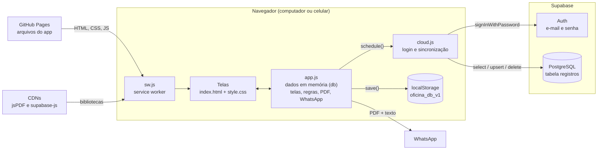
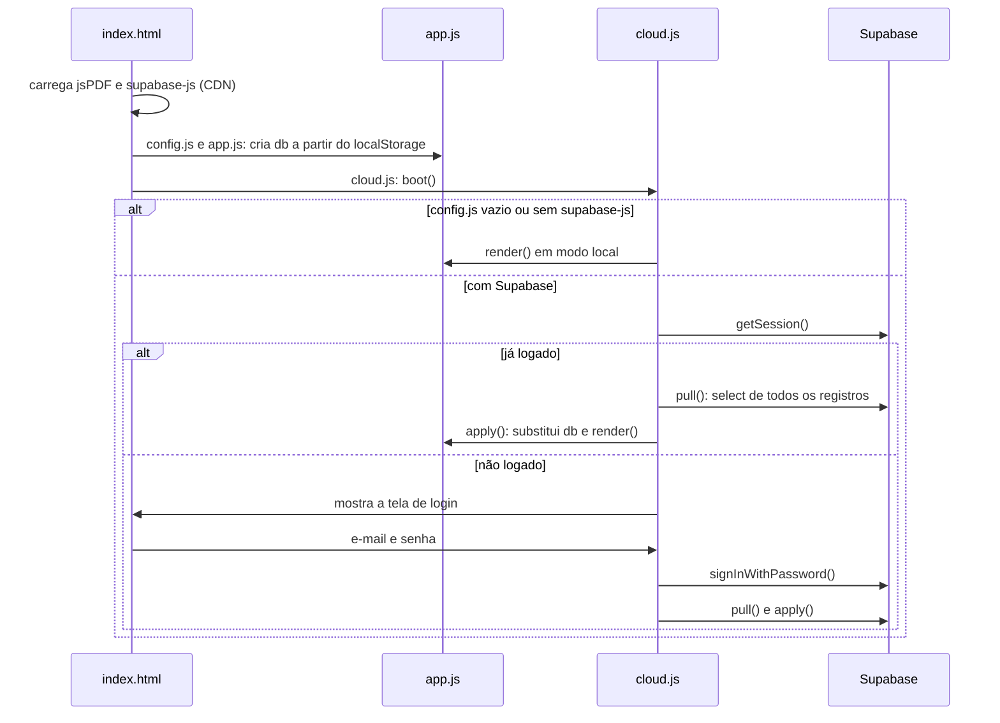
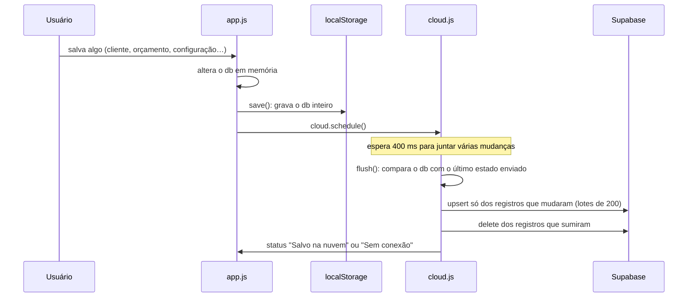
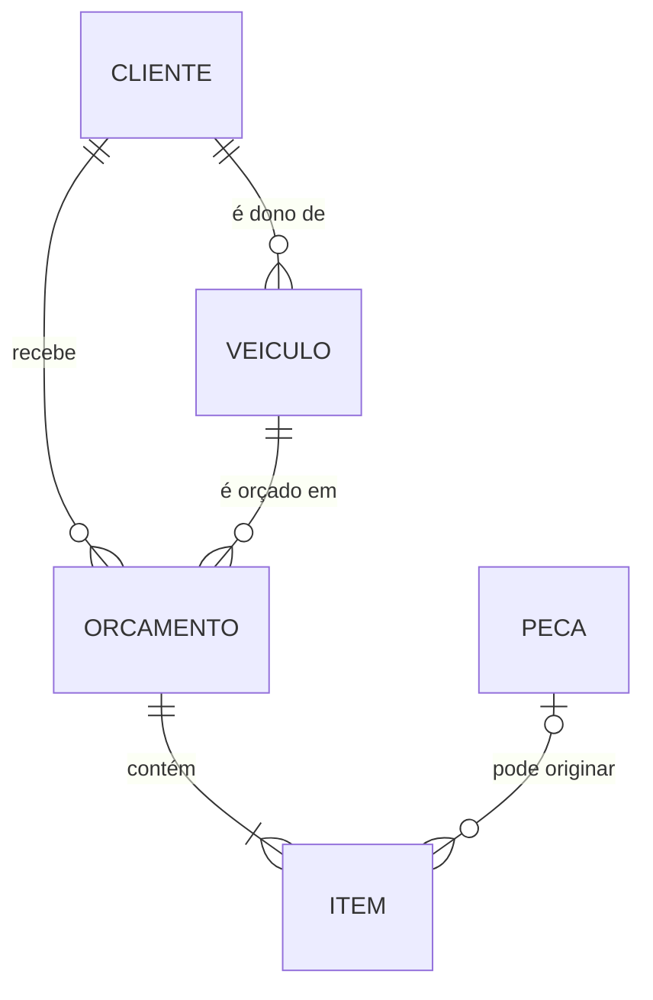

# Oficina — Gestão (Mecânica Rodrigues)

Aplicativo web para a oficina controlar **clientes, veículos, peças e orçamentos**, gerar o orçamento em **PDF** e enviá-lo pelo **WhatsApp**. Funciona no navegador do computador e pode ser instalado no celular como app (PWA).

- **Endereço publicado:** https://nlucasjr.github.io/oficina-app/
- **Banco de dados e login:** Supabase
- **Sem etapa de build:** são arquivos HTML, CSS e JavaScript puros, servidos como estão.

---

## Sumário

1. [Tecnologias](#tecnologias)
2. [Estrutura dos arquivos](#estrutura-dos-arquivos)
3. [Visão geral da arquitetura](#visão-geral-da-arquitetura)
4. [Como as partes se comunicam](#como-as-partes-se-comunicam)
5. [Modelo de dados](#modelo-de-dados)
6. [Segurança e usuários](#segurança-e-usuários)
7. [PDF e WhatsApp](#pdf-e-whatsapp)
8. [PWA e service worker](#pwa-e-service-worker)
9. [Rodar, configurar e publicar](#rodar-configurar-e-publicar)
10. [Limitações conhecidas](#limitações-conhecidas)

---

## Tecnologias

| Camada | Tecnologia | Para que serve |
|---|---|---|
| Interface | HTML, CSS e JavaScript puro (sem framework) | Telas, formulários e regras do app |
| Banco de dados | [Supabase](https://supabase.com) (PostgreSQL) | Guarda os dados na nuvem, compartilhados entre aparelhos |
| Login | Supabase Auth (e-mail e senha) | Só usuários cadastrados entram |
| Biblioteca do banco | `supabase-js` 2.117.2 (via CDN jsDelivr) | Faz login e lê/grava a tabela pelo navegador |
| PDF | `jsPDF` 2.5.1 + `jspdf-autotable` 3.8.2 (via CDN cdnjs) | Gera o PDF do orçamento no próprio navegador |
| Cópia local | `localStorage` do navegador | Cache dos dados e modo local sem nuvem |
| App no celular | Web App Manifest + Service Worker | Instalação na tela inicial e abertura rápida |
| Hospedagem | GitHub Pages (branch `main`) | Publica o site em HTTPS a cada push |

Não há servidor próprio: o navegador fala direto com o Supabase. O GitHub Pages só entrega os arquivos.

---

## Estrutura dos arquivos

```
oficina-app/
├── index.html        Esqueleto da página: menu, área principal, tela de login, janela (modal) e aviso (toast).
│                     Carrega as bibliotecas de CDN e os scripts do app, nesta ordem.
├── config.js         URL e chave pública do Supabase. Vazio = modo local (sem nuvem).
├── app.js            O app em si: dados em memória, telas, formulários, editor de orçamento,
│                     PDF, WhatsApp, roteamento e eventos.
├── cloud.js          Login e sincronização com o Supabase. Inicia o app (boot).
├── style.css         Visual do app; inclui o layout de celular (barra inferior, listas em cartões).
├── sw.js             Service worker (cache dos arquivos para o PWA).
├── manifest.json     Nome, cores e ícones do app instalável.
├── icons/            Ícones do app (192, 512, maskable e apple-touch).
├── logo.png          Logo da barra lateral (fundo escuro).
├── logo-branco.png   Logo da tela de login (fundo branco).
└── supabase.sql      Script que cria a tabela e as regras de acesso no Supabase.
```

---

## Visão geral da arquitetura



O app é uma **página única** (SPA). Tudo acontece no navegador:

- **`app.js`** mantém todos os dados num objeto em memória chamado `db` e desenha a tela a partir dele.
- **`cloud.js`** cuida de quem está logado e de manter o `db` igual ao que está no Supabase.
- **`localStorage`** guarda uma cópia do `db` no aparelho.

---

## Como as partes se comunicam

### 1. Abertura do app



Na **primeira vez** que alguém entra num banco vazio, se o navegador já tinha dados do modo local, o `cloud.js` envia esses dados para a nuvem.

### 2. Telas e navegação

- O endereço depois do `#` decide a tela (**roteamento por hash**). A função `render()` lê o hash, monta o HTML da tela e coloca dentro de `<main id="main">`. Toda mudança de hash chama `render()` de novo.

| Hash | Tela |
|---|---|
| `#painel` | Resumo do mês e últimos orçamentos |
| `#orcamentos` | Lista de orçamentos (busca e filtro por status) |
| `#orcamento/novo?cliente=…&veiculo=…` | Novo orçamento (cliente e veículo opcionais) |
| `#orcamento/<id>` | Editor de um orçamento |
| `#clientes` / `#cliente/<id>` | Lista e ficha do cliente |
| `#veiculos` / `#veiculo/<id>` | Lista e histórico do veículo |
| `#pecas` | Catálogo de peças e materiais |
| `#config` | Dados da oficina, logo do PDF e backup |

- **Botões** usam o atributo `data-act="nomeDaAcao"`. Um único ouvinte de clique em `app.js` procura esse atributo e chama a função correspondente no objeto `actions` (ex.: `salvarOrc`, `pdf`, `whats`, `novoCliente`).
- **Cadastros** (cliente, veículo, peça) abrem num formulário em janela (`formModal`), que valida e devolve os valores.
- **Editor de orçamento**: enquanto você edita, as mudanças ficam num rascunho (`draft`). Os totais são recalculados a cada tecla. O orçamento só entra no `db` ao clicar em **Salvar**, **PDF** ou **WhatsApp**.

### 3. Salvar e sincronizar



- **Só o que mudou é enviado.** O `cloud.js` guarda o último JSON enviado de cada registro (`cloud.synced`) e compara. Assim dois computadores podem trabalhar ao mesmo tempo sem apagar o trabalho um do outro, desde que não editem **o mesmo** registro.
- **Se a rede falhar**, ele tenta de novo a cada 5 segundos e mostra "Sem conexão, tentando de novo".
- **Receber mudanças de outro aparelho:** a cada 60 segundos, e sempre que a aba volta a ficar visível, o `cloud.refresh()` baixa tudo do Supabase e atualiza a tela. Ele não faz isso enquanto há algo pendente de envio ou um formulário aberto, para não atrapalhar quem está editando.
- **Conflito:** se dois aparelhos alteram o mesmo registro, vale o último que salvou.
- O **status** aparece no canto da barra lateral (ou no cabeçalho, no celular): "Salvo na nuvem", "Salvando...", "Sem conexão, tentando de novo" ou "Modo local (sem nuvem)".

### 4. Modo local

Se o `config.js` estiver vazio, ou se a biblioteca do Supabase não carregar, o app funciona **só no navegador**, guardando tudo no `localStorage`. Nesse modo o backup em **Configurações → Backup** é a única forma de levar os dados para outro aparelho.

---

## Modelo de dados

### No Supabase: uma tabela só

```sql
registros (
  tipo        text,         -- 'clientes' | 'veiculos' | 'pecas' | 'orcamentos' | 'config'
  id          text,         -- id gerado no navegador; 'main' para a config
  data        jsonb,        -- o objeto completo
  updated_at  timestamptz,
  primary key (tipo, id)
)
```

Cada cliente, veículo, peça e orçamento é **uma linha**, com o objeto inteiro no campo JSON `data`. As configurações da oficina são a linha `tipo = 'config'`, `id = 'main'`. Não existem colunas separadas para telefone, placa etc.: tudo fica dentro do `data`.

### No navegador: o objeto `db`

```text
db
├── config      { nome, cnpj, telefone, email, endereco, validade, margem, logo, rodape }
├── clientes    [ { id, nome, telefone, doc, email, endereco, obs, criado } ]
├── veiculos    [ { id, clienteId, placa, marca, modelo, ano, cor, km, chassi, obs, criado } ]
├── pecas       [ { id, nome, codigo, marca, unidade, custo, preco, estoque } ]
└── orcamentos  [ { id, numero, data, validade, status, clienteId, veiculoId, km,
                    problema, obs, desconto, pagamento, prazo,
                    itens: [ { tipo: 'peca'|'servico', pecaId, descricao,
                               qtd, custo, valor, unidade } ] } ]
```



Regras importantes:

- **Status do orçamento:** `aberto`, `aprovado`, `recusado`, `concluido`. O painel soma no faturamento só os aprovados e concluídos do mês.
- **Itens copiam os dados da peça.** Ao escolher uma peça do catálogo, descrição, custo e preço são copiados para o item. Mudar a peça depois não altera orçamentos antigos.
- **Custo e lucro são internos:** aparecem na tela, mas não saem no PDF nem na mensagem.
- **Preço de venda vazio** numa peça = custo + margem padrão das Configurações.
- **Km do veículo** é atualizado quando um orçamento registra uma quilometragem maior.
- **Exclusão protegida:** cliente com veículos ou orçamentos, e veículo com orçamentos, não podem ser excluídos.
- **Logo do PDF** (Configurações) fica guardada como imagem em texto (data URL) dentro da config. É diferente dos arquivos `logo.png` e `logo-branco.png`, usados só na interface.

---

## Segurança e usuários

- A **chave do `config.js`** é a chave *publishable* do Supabase. Ela pode ficar pública: quem protege os dados é o login e as regras do banco.
- O **`supabase.sql`** liga o *Row Level Security* na tabela e só permite ler e gravar a usuários **logados** (`authenticated`). Visitantes anônimos não têm acesso.
- **Há um único tipo de usuário.** Todos os logados veem e alteram tudo. Não existem perfis (administrador, atendente etc.).
- **Usuários são criados manualmente** no painel do Supabase (Authentication → Users). O app não tem tela de cadastro.
- Ao clicar em **Sair**, o app encerra a sessão e apaga a cópia local dos dados daquele navegador.

---

## PDF e WhatsApp

**PDF** (`gerarPDF` em `app.js`): montado no próprio navegador com jsPDF. Contém:

- cabeçalho com logo, dados da oficina e número do orçamento;
- quadros do cliente e do veículo;
- problema relatado;
- tabelas de peças e serviços (via autoTable);
- totais, prazo, pagamento, observações, linha de aprovação do cliente e rodapé de garantia.

**WhatsApp** (`enviarWhats`): monta um texto com a formatação do WhatsApp (`*negrito*`, `_itálico_`) com o orçamento completo (`textoOrcamento`) e:

| Onde | O que acontece |
|---|---|
| Celular com suporte a compartilhar arquivos | Abre o compartilhamento do sistema com **PDF + texto** juntos; você escolhe o WhatsApp e o contato. O texto também é copiado, caso o app de destino descarte o texto. |
| Computador (ou celular sem suporte) | Baixa o PDF e abre `wa.me/<telefone do cliente>` com o texto pronto; basta anexar o PDF na conversa. |

O link `wa.me` não permite anexar arquivos. Por isso o PDF só vai junto no celular, pelo compartilhamento do sistema.

---

## PWA e service worker

- **`manifest.json`** dá nome, cores (`#201e1f`) e ícones ao app instalável. No iPhone, as tags `apple-*` do `index.html` fazem o mesmo papel.
- **`sw.js`** intercepta os pedidos da página:
  - **arquivos do app:** busca primeiro na rede, para as atualizações chegarem logo, e usa a cópia guardada só sem sinal;
  - **bibliotecas de CDN:** usa a cópia guardada depois do primeiro uso;
  - **Supabase (login e dados):** nunca passa pelo cache; vai sempre direto à rede.
- Ao mudar a lista de arquivos do `sw.js` ou as versões das bibliotecas, **aumente o número em `CACHE`** (ex.: `oficina-v2` → `oficina-v3`) para os aparelhos descartarem o cache antigo.

---

## Rodar, configurar e publicar

### Rodar no computador

Basta servir a pasta com qualquer servidor estático:

```bash
# com Python
py -m http.server 8080        # Windows
python3 -m http.server 8080   # macOS / Linux
# abra http://localhost:8080

# ou com Node
npx live-server
```

Também funciona com a extensão **Live Server** do VS Code (botão *Go Live*). Abrir o `index.html` direto pelo arquivo (`file://`) não funciona bem: o service worker e o login precisam de um endereço `http(s)`.

### Configurar o Supabase (uma vez)

1. Crie um projeto no Supabase.
2. Em **SQL Editor**, rode o conteúdo de `supabase.sql`.
3. Em **Authentication → Users**, crie os usuários (e-mail e senha).
4. Em **Project Settings → API Keys**, copie a URL do projeto e a chave *publishable* para o `config.js`.

Para usar sem nuvem, deixe `supabaseUrl` e `supabaseKey` vazios no `config.js`.

### Publicar

Todo push na `main` publica automaticamente no GitHub Pages (Settings → Pages). Em um ou dois minutos o site é atualizado. Se usar o app instalado, feche e abra de novo para pegar a versão nova.

---

## Limitações conhecidas

- **Numeração dos orçamentos:** o próximo número é calculado no navegador (maior número existente + 1). Se dois aparelhos criarem um orçamento no mesmo instante, podem gerar o mesmo número.
- **Conflitos:** a sincronização é por registro e vale o último que salvou. Duas pessoas editando o mesmo orçamento ao mesmo tempo podem sobrescrever uma à outra.
- **Offline:** o app abre sem internet, mas o login e o carregamento dos dados precisam de conexão. Edições feitas sem rede ficam pendentes e se perdem se o app for fechado antes de sincronizar.
- **Sem perfis de acesso:** qualquer usuário logado pode alterar e excluir tudo.
- **Logo do PDF dentro do banco:** uma imagem muito grande deixa a linha de configuração pesada; prefira imagens pequenas.
- **Bibliotecas por CDN:** sem acesso ao cdnjs/jsDelivr na primeira abertura, o PDF e a nuvem não funcionam.
