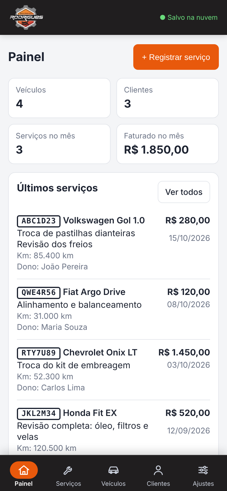
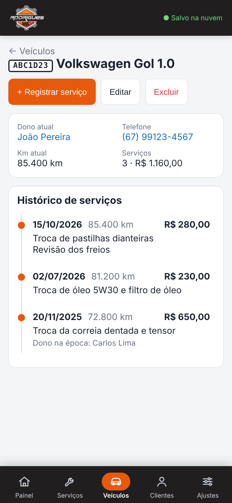
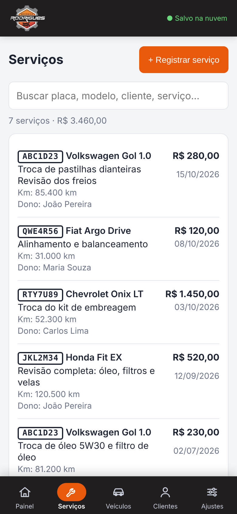
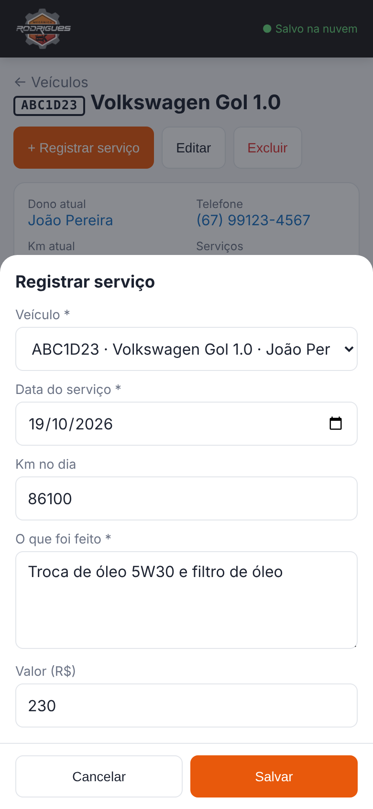
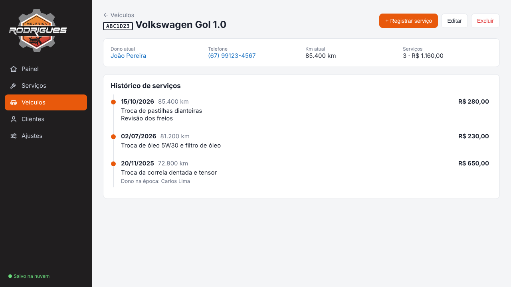
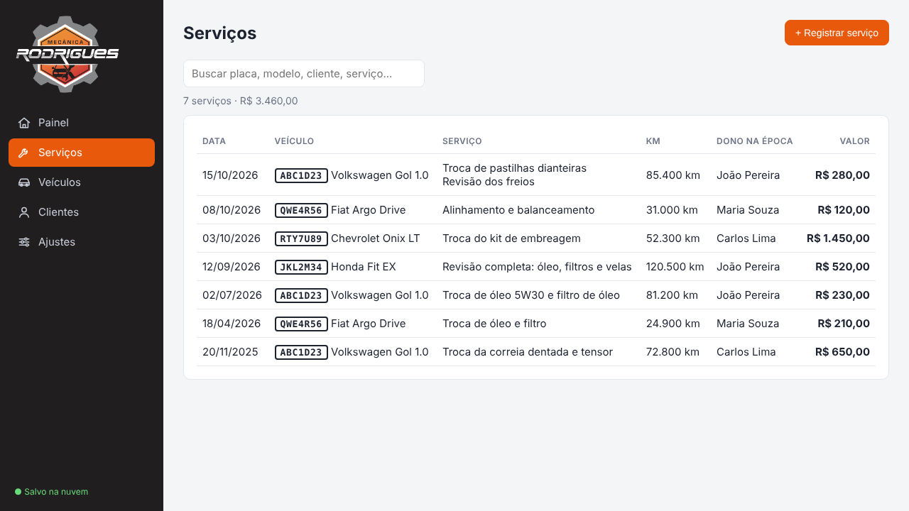
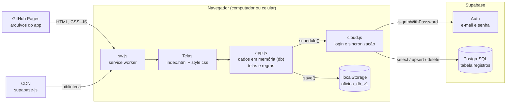
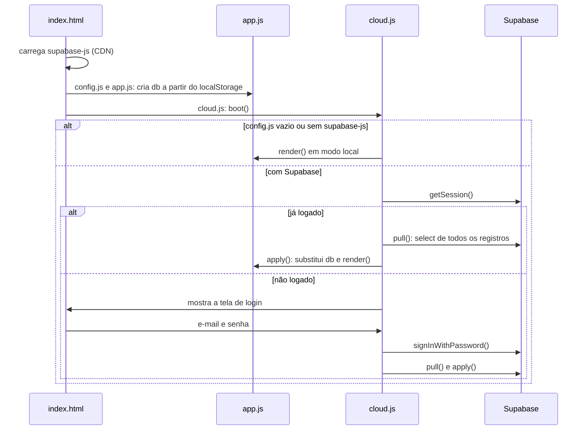
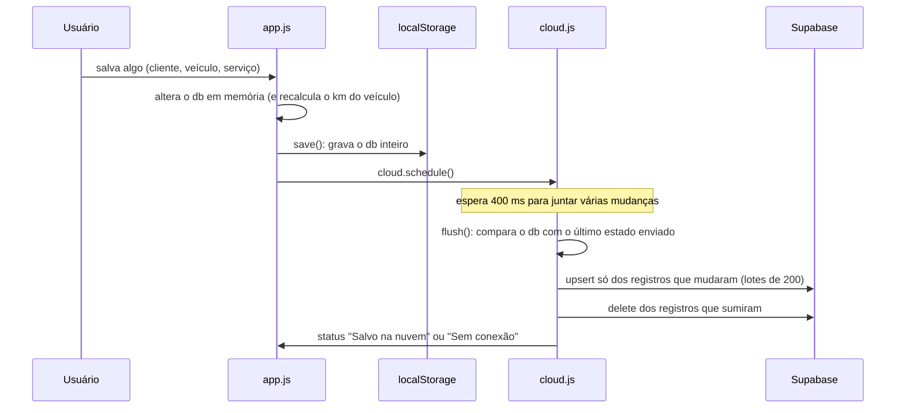
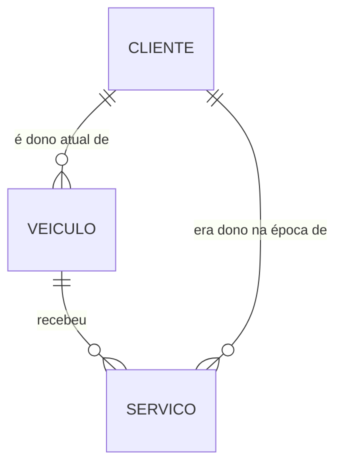

# Oficina — Histórico de serviços (Mecânica Rodrigues)

Aplicativo web para a oficina manter o **histórico de serviços de cada veículo**: o que foi feito, quando, com qual quilometragem, quanto custou e quem era o dono do carro naquele dia. Funciona no navegador do computador e pode ser instalado no celular como app (PWA).

- **Endereço publicado:** https://nlucasjr.github.io/oficina-app/
- **Banco de dados e login:** Supabase
- **Sem etapa de build:** são arquivos HTML, CSS e JavaScript puros, servidos como estão.

---

## Telas

As imagens usam dados de exemplo (fictícios).

### No celular

<table>
  <tr>
    <td align="center"><br><sub><b>Painel</b><br>resumo do mês e últimos serviços</sub></td>
    <td align="center"><br><sub><b>Histórico do veículo</b><br>data, km, valor e dono na época</sub></td>
    <td align="center"><br><sub><b>Serviços</b><br>todos os serviços, com busca</sub></td>
    <td align="center"><br><sub><b>Registrar serviço</b><br>veículo, data, km, o que foi feito e valor</sub></td>
  </tr>
</table>

### No computador

<p align="center"></p>
<p align="center"><sub><b>Histórico do veículo</b>: o serviço de 20/11/2025 mostra o dono da época, porque o carro mudou de dono depois.</sub></p>

<p align="center"></p>
<p align="center"><sub><b>Serviços</b>: todos os serviços da oficina, do mais recente para o mais antigo.</sub></p>

---

## Sumário

1. [Telas](#telas)
1. [O que o app guarda](#o-que-o-app-guarda)
2. [Tecnologias](#tecnologias)
3. [Estrutura dos arquivos](#estrutura-dos-arquivos)
4. [Visão geral da arquitetura](#visão-geral-da-arquitetura)
5. [Como as partes se comunicam](#como-as-partes-se-comunicam)
6. [Modelo de dados](#modelo-de-dados)
7. [Segurança e usuários](#segurança-e-usuários)
8. [PWA e service worker](#pwa-e-service-worker)
9. [Rodar, configurar e publicar](#rodar-configurar-e-publicar)
10. [Limitações conhecidas](#limitações-conhecidas)

---

## O que o app guarda

| Cadastro | Campos |
|---|---|
| **Cliente** | nome, telefone, endereço |
| **Veículo** | placa, marca, modelo, km atual e dono (um cliente) |
| **Serviço** | veículo, data, km no dia, o que foi feito, valor e dono na época |

Regras principais:

- **Km atual do veículo** acompanha o serviço **mais recente** (pela data) que tenha km informado. Registrar, editar ou excluir um serviço recalcula o km. Um serviço lançado com data antiga não muda o km atual.
- **Km menor que o anterior:** se um serviço tiver km menor do que o de um serviço anterior do mesmo carro, o app pergunta antes de salvar (costuma ser erro de digitação).
- **Dono na época:** cada serviço guarda quem era o dono quando foi registrado. Se o carro for vendido (troca de dono no cadastro do veículo), o histórico continua mostrando o dono antigo nos serviços antigos ("Dono na época: …"), e a ficha do cliente antigo continua listando os serviços feitos para ele.
- **Exclusões protegidas:** um veículo com serviços no histórico não pode ser excluído, e um cliente que é dono de veículos ou aparece no histórico também não.

---

## Tecnologias

| Camada | Tecnologia | Para que serve |
|---|---|---|
| Interface | HTML, CSS e JavaScript puro (sem framework) | Telas, formulários e regras do app |
| Banco de dados | [Supabase](https://supabase.com) (PostgreSQL) | Guarda os dados na nuvem, compartilhados entre aparelhos |
| Login | Supabase Auth (e-mail e senha) | Só usuários cadastrados entram |
| Biblioteca do banco | `supabase-js` 2.117.2 (via CDN jsDelivr) | Faz login e lê/grava a tabela pelo navegador |
| Cópia local | `localStorage` do navegador | Cache dos dados e modo local sem nuvem |
| App no celular | Web App Manifest + Service Worker | Instalação na tela inicial e abertura rápida |
| Hospedagem | GitHub Pages (branch `main`) | Publica o site em HTTPS a cada push |

Não há servidor próprio: o navegador fala direto com o Supabase. O GitHub Pages só entrega os arquivos.

---

## Estrutura dos arquivos

```
oficina-app/
├── index.html        Esqueleto da página: menu, área principal, tela de login, janela (modal) e aviso (toast).
├── config.js         URL e chave pública do Supabase. Vazio = modo local (sem nuvem).
├── app.js            O app em si: dados em memória, telas, formulários, regras de km e dono, backup e roteamento.
├── cloud.js          Login e sincronização com o Supabase. Inicia o app (boot).
├── style.css         Visual do app; inclui o layout de celular (barra inferior, listas em cartões).
├── sw.js             Service worker (cache dos arquivos para o PWA).
├── manifest.json     Nome, cores e ícones do app instalável.
├── icons/            Ícones do app (192, 512, maskable e apple-touch).
├── logo.png          Logo da barra lateral (fundo escuro).
├── logo-branco.png   Logo da tela de login (fundo branco).
├── docs/screenshots/ Imagens das telas usadas neste README.
└── supabase.sql      Script que cria a tabela e as regras de acesso no Supabase.
```

---

## Visão geral da arquitetura



O app é uma **página única** (SPA). Tudo acontece no navegador:

- **`app.js`** mantém todos os dados num objeto em memória chamado `db` e desenha a tela a partir dele.
- **`cloud.js`** cuida de quem está logado e de manter o `db` igual ao que está no Supabase.
- **`localStorage`** guarda uma cópia do `db` no aparelho.

---

## Como as partes se comunicam

### 1. Abertura do app



Na **primeira vez** que alguém entra num banco vazio, se o navegador já tinha dados do modo local, o `cloud.js` envia esses dados para a nuvem.

### 2. Telas e navegação

O endereço depois do `#` decide a tela (**roteamento por hash**). A função `render()` lê o hash, monta o HTML da tela e coloca dentro de `<main id="main">`. Toda mudança de hash chama `render()` de novo.

| Hash | Tela |
|---|---|
| `#painel` | Resumo (veículos, clientes, serviços e faturado no mês) e últimos serviços |
| `#servicos` | Todos os serviços, com busca por placa, marca, modelo, cliente, descrição ou data |
| `#veiculos` / `#veiculo/<id>` | Lista de veículos e a ficha do veículo com o **histórico de serviços** |
| `#clientes` / `#cliente/<id>` | Lista de clientes e a ficha com veículos e serviços feitos para ele |
| `#config` | Ajustes: backup dos dados |

- **Botões** usam o atributo `data-act="nomeDaAcao"`. Um único ouvinte de clique em `app.js` procura esse atributo e chama a função correspondente no objeto `actions` (ex.: `novoServico`, `editVeiculo`, `exportar`).
- **Cadastros e serviços** abrem num formulário em janela (`formModal`), que valida e devolve os valores. Tocar num serviço da lista ou do histórico abre a edição, com o botão Excluir.
- No celular, o menu vira uma **barra inferior** e as listas viram **cartões**.

### 3. Salvar e sincronizar



- **Só o que mudou é enviado.** O `cloud.js` guarda o último JSON enviado de cada registro (`cloud.synced`) e compara. Assim dois aparelhos podem trabalhar ao mesmo tempo sem apagar o trabalho um do outro, desde que não editem **o mesmo** registro.
- **Se a rede falhar**, ele tenta de novo a cada 5 segundos e mostra "Sem conexão, tentando de novo".
- **Receber mudanças de outro aparelho:** a cada 60 segundos, e sempre que a aba volta a ficar visível, o `cloud.refresh()` baixa tudo do Supabase e atualiza a tela. Ele não faz isso enquanto há algo pendente de envio ou um formulário aberto.
- **Conflito:** se dois aparelhos alteram o mesmo registro, vale o último que salvou.
- **Tipos desconhecidos são ignorados:** o app só lê e grava `clientes`, `veiculos`, `servicos` e `config`.
- O **status** aparece no canto da barra lateral (ou no cabeçalho, no celular): "Salvo na nuvem", "Salvando...", "Sem conexão, tentando de novo" ou "Modo local (sem nuvem)".

### 4. Modo local

Se o `config.js` estiver vazio, ou se a biblioteca do Supabase não carregar, o app funciona **só no navegador**, guardando tudo no `localStorage`. Nesse modo o backup em **Ajustes** é a única forma de levar os dados para outro aparelho.

---

## Modelo de dados

### No Supabase: uma tabela só

```sql
registros (
  tipo        text,         -- 'clientes' | 'veiculos' | 'servicos' | 'config'
  id          text,         -- id gerado no navegador; 'main' para a config
  data        jsonb,        -- o objeto completo
  updated_at  timestamptz,
  primary key (tipo, id)
)
```

Cada cliente, veículo e serviço é **uma linha**, com o objeto inteiro no campo JSON `data`. Não existem colunas separadas para telefone, placa etc.: tudo fica dentro do `data`.

### No navegador: o objeto `db`

```text
db
├── config    { nome }
├── clientes  [ { id, nome, telefone, endereco, criado } ]
├── veiculos  [ { id, clienteId, placa, marca, modelo, km, criado } ]
└── servicos  [ { id, veiculoId, clienteId, data, km, descricao, valor, criado } ]
```



- `servicos.clienteId` é o **dono na época** do serviço; `veiculos.clienteId` é o **dono atual**.
- `veiculos.km` é o km atual; `servicos.km` é o km no dia do serviço.
- `valor` e `km` podem ficar vazios.

---

## Segurança e usuários

- A **chave do `config.js`** é a chave *publishable* do Supabase. Ela pode ficar pública: quem protege os dados é o login e as regras do banco.
- O **`supabase.sql`** liga o *Row Level Security* na tabela e só permite ler e gravar a usuários **logados** (`authenticated`). Visitantes não têm acesso.
- **Há um único tipo de usuário.** Todos os logados veem e alteram tudo.
- **Usuários são criados manualmente** no painel do Supabase (Authentication → Users). O app não tem tela de cadastro.
- Ao clicar em **Sair**, o app encerra a sessão e apaga a cópia local dos dados daquele navegador.

---

## PWA e service worker

- **`manifest.json`** dá nome, cores (`#201e1f`) e ícones ao app instalável. No iPhone, as tags `apple-*` do `index.html` fazem o mesmo papel.
- **`sw.js`** intercepta os pedidos da página:
  - **arquivos do app:** busca primeiro na rede, para as atualizações chegarem logo, e usa a cópia guardada só sem sinal;
  - **biblioteca do Supabase (CDN):** usa a cópia guardada depois do primeiro uso;
  - **Supabase (login e dados):** nunca passa pelo cache; vai sempre direto à rede.
- Ao mudar a lista de arquivos do `sw.js` ou a versão da biblioteca, **aumente o número em `CACHE`** (ex.: `oficina-v3` → `oficina-v4`).

---

## Rodar, configurar e publicar

### Rodar no computador

Basta servir a pasta com qualquer servidor estático:

```bash
# com Python
py -m http.server 8080        # Windows
python3 -m http.server 8080   # macOS / Linux
# abra http://localhost:8080

# ou com Node
npx live-server
```

Também funciona com a extensão **Live Server** do VS Code (botão *Go Live*). Abrir o `index.html` direto pelo arquivo (`file://`) não funciona bem: o service worker e o login precisam de um endereço `http(s)`.

### Configurar o Supabase

1. Crie um projeto no Supabase.
2. Em **SQL Editor**, rode o conteúdo de `supabase.sql`. Ele pode ser rodado de novo; faça isso sempre que o arquivo mudar.
3. Em **Authentication → Users**, crie os usuários (e-mail e senha).
4. Em **Project Settings → API Keys**, copie a URL do projeto e a chave *publishable* para o `config.js`.

Para usar sem nuvem, deixe `supabaseUrl` e `supabaseKey` vazios no `config.js`.

O `supabase.sql` também apaga os restos da versão anterior do app (orçamentos, peças e as funções de numeração e de link de aprovação).

### Publicar

Todo push na `main` publica automaticamente no GitHub Pages (Settings → Pages). Em um ou dois minutos o site é atualizado. Se usar o app instalado, feche e abra de novo para pegar a versão nova.

---

## Limitações conhecidas

- **Conflitos:** a sincronização é por registro e vale o último que salvou. Duas pessoas editando o mesmo serviço ao mesmo tempo podem sobrescrever uma à outra.
- **Offline:** o app abre sem internet, mas o login e o carregamento dos dados precisam de conexão. Edições feitas sem rede ficam pendentes e se perdem se o app for fechado antes de sincronizar.
- **Sem perfis de acesso:** qualquer usuário logado pode alterar e excluir tudo.
- **Versões antigas abertas:** uma aba ou app instalado ainda com a versão anterior não conhece os serviços e pode apagá-los do banco ao salvar algo. Depois de atualizar, feche e abra o app em todos os aparelhos.
